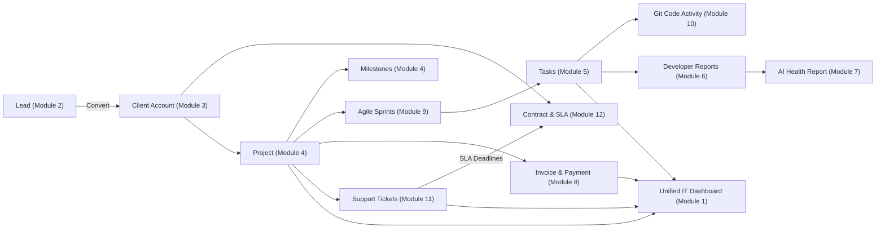

# IT Consultant — IT Services & Software Development ERP

[](https://nodejs.org/)
[](https://react.dev/)
[](https://expressjs.com/)
[](https://www.mongodb.com/atlas)
[](https://tailwindcss.com/)

**IT Consultant** is a full-stack enterprise **IT Services CRM & Project Management ERP** tailored specifically for software development firms, digital agencies, and IT consulting organizations.

---

## 🌟 The 12 ERP Modules

### 1. Executive Dashboard & Command Center
- Real-time project progress, active delivery status, and delayed milestones.
- Developer workload distribution, completed vs. pending tasks.
- Financial health: Revenue, expenditures, receivables, and cash flow.
- Open support tickets, critical bug counts, and breached SLA alerts.

### 2. Client & Lead Management
- Full B2B sales pipeline tracking: *New, Contacted, Follow-up, Qualified, Proposal, Won, Lost*.
- Estimated project budgets, service requirements, and timestamped follow-up history.
- Duplicate-safe, one-click conversion of qualified leads into official Client Accounts.

### 3. Client & Account Management
- Comprehensive company profiles, primary technical/billing contacts, and agreements.
- Centralized relationship timeline: linked projects, invoices, payments, and support history.
- Search, filter, and export capabilities.

### 4. Project Management
- Detailed project scoping: tech stack, repositories, budgets, start/target delivery dates.
- Milestone and deliverable tracking with automated overdue delivery alerts.
- Grouped employee allocations by engineering, design, and operations departments.

### 5. Task Management
- Developer task assignments linked directly to projects, milestones, and sprints.
- Priority classifications, story points, deadlines, and task attachments.
- Interactive status boards with activity history and internal discussions.

### 6. Developer Reports
- Daily developer shift standup reports.
- Pull request and commit references tied to assigned project tasks.
- Blocker and dependency tracking for engineering leads.

### 7. AI Project Health Reports
- Automated project delivery risk analysis and bottleneck identification.
- Strict factual grounding: clearly distinguishes verified database facts from AI assessments.
- Smart caching and rule-based fallback when external AI services are unavailable.

### 8. Accounts & Finance
- Project-linked invoices with itemized deliverables, taxes, and discounts.
- Income, expenditures, and partial payment reconciliation.
- Client-wise and project-wise profitability and budget tracking.

### 9. Agile Sprint Board
- Sprints linked directly to projects with effort estimation and velocity metrics.
- Interactive drag-and-drop Kanban board (`@hello-pangea/dnd`).
- Real-time synchronization between sprint boards and database task records.

### 10. Git Integration & Code Auditing
- GitHub, GitLab, and Bitbucket webhook handlers with HMAC-SHA256 signature verification.
- Commits and pull requests automatically parsed and linked to matching project tasks.
- Live engineering audit feed and event logging.

### 11. Bug Tracking & Support Desk
- Project- and client-linked issue ticketing with priority categorization.
- Dual-layer discussion system: client-facing communication vs. internal engineering comments.
- Client data isolation ensuring clients only view their own issues.

### 12. SLA & Maintenance Contracts
- 24/7 and business-hour service contracts, SLA tiers (Platinum, Gold, Silver).
- Automated SLA response and resolution deadline calculation upon ticket creation.
- Live breach detection, renewal reminders, and SLA compliance analytics.

---

## 🔄 End-to-End Connected Workflow



---

## 🛠️ Technology Stack

- **Frontend:** React 19, Vite, Tailwind CSS v4, Lucide React, Framer Motion
- **Backend:** Node.js, Express.js (ES Modules)
- **Database:** MongoDB Atlas (Mongoose ORM)
- **Caching & Sessions:** Redis
- **Authentication:** JWT (RS256/HS256), Bcryptjs, Granular RBAC
- **AI Engine:** Groq SDK (`groq-sdk`)

---

## 🚀 Getting Started

### Prerequisites
- Node.js (v18 or higher)
- npm (v9 or higher)
- MongoDB Atlas connection URI

### 1. Environment Configuration

Copy the example environment files in both folders:

```bash
# In backend/
cp .env.example .env

# In front crm/
cp .env.example .env
```

### 2. Install Dependencies

```bash
# Backend dependencies
cd backend
npm install

# Frontend dependencies
cd "../front crm"
npm install
```

### 3. Run Development Servers

```bash
# Start Backend (Port 5000)
cd backend
npm run dev

# Start Frontend (Port 5173)
cd "../front crm"
npm run dev
```

---

## 🧪 Testing & Verification

The suite includes comprehensive automated tests covering all 12 ERP modules:

```bash
cd backend

# Run the 12-Module End-to-End ERP Test Suite
npm run test:erp

# Run Lead Unit Tests
npm test

# Run Client Module API Tests
npm run test:client
```

---

## 📄 License
Internal proprietary software for IT Consultant.
